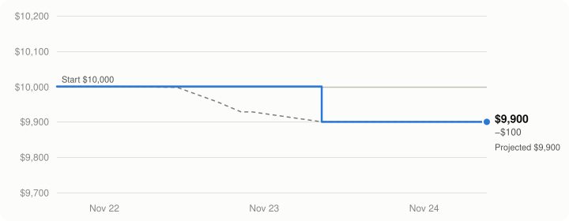

# Kalshi bot

**Updated Mon Nov 23, 10:18 PM EST** · runs when you press Run · [▶ Run now](https://github.com/noffenkrantz/kalshi-bot/actions/workflows/bot.yml) · [Results site](https://noffenkrantz.github.io/kalshi-bot/) · [Full report](REPORT.md) · [Where prices lag](LAGS.md) · [Last run log](data/last_run.log) · [Setup & settings](SETUP.md)

## 💵 Simulated account

*Real Kalshi markets at real prices, with Kalshi's fees, settled on what actually happened. The money is pretend: nothing is ever bought.*

### $9,900.03
−$99.97 since the start ($10,000.00 pretend bankroll). Real balance: settled bets only.

<picture>
  <source media="(prefers-color-scheme: dark)" srcset="data/balance-dark.svg">
  
</picture>

0 open trades ($0.00 in) · 1 settled: 0 won, 1 lost, −$99.97 · projected = what an open trade would be worth if it ended at today's price, shown once its price has moved

**Settled trades**

| Market | Bet | Result | P&L |
|---|---|---|---|
| US gas prices tomorrow — Above 3.6350 | 131 NO @ 75¢ | ❌ lost | −$99.97 |

## 🎯 Is Claude beating the market?

**The market is ahead**: accuracy score 0.287 for Claude vs 0.202 for the market price (lower is better) on 18 resolved forecasts. Too early to trust: 18/100 resolved.

## 🧠 What Claude is learning

**Where Claude is good** (settled forecasts where Claude and the market disagreed by 5+ points)

| Topic | Claude beat the market | Research focus |
|---|---|---|
| Climate and Weather | 1 of 7 | ⬇ less |
| Politics | 2 of 3 | normal |
| Economics | 1 of 3 | ⬇ less |

*20% of research is always spread at random, so every topic keeps getting chances.*

**Post-mortems:** 1 settled bet reviewed: 0 good calls, 1 bad luck, 0 process mistakes.
- 🎲 US gas prices tomorrow — Above 3.6350: AAA's national average fell only about 0.82 cents on Nov 23, from $3.6448 to $3.6366. That stayed just above…

**Lessons learned (0)** · [see all or edit](data/lessons.md)
- None yet. Only process mistakes become lessons, never bad luck.

## 🔮 Latest forecasts

| Market | Claude | Market | Sure? |
|---|---|---|---|
| S&P price on Nov 24, 2026 at 4pm EST? — 7… | 50% | 57% | medium-low |
| S&P price on Nov 24, 2026 at 4pm EST? — 7… | 76% | 94% | medium-low |
| Where will it rain on Nov 24, 2026? — Tam… | 20% | 40% | medium |
| Michigan gas price tomorrow — Large decre… | 50% | 15% | medium-low |
| Diesel prices tomorrow — Above $5.805 | 6% | 10% | medium |
| US gas prices tomorrow — Above 3.6150 | 52% | 15% | medium-low |
| Highest temperature in Los Angeles on Nov… | 10% | 6% | medium-low |
| Trump's RCP approval average on Nov 23, 2… | 40% | 40% | medium-low |
| Connecticut gas price tomorrow — Small de… | 42% | 72% | medium |
| Vermont gas price tomorrow — Large decrea… | 45% | 42% | medium-low |

---
*Simulated trades only, no real money. Not financial advice.*
